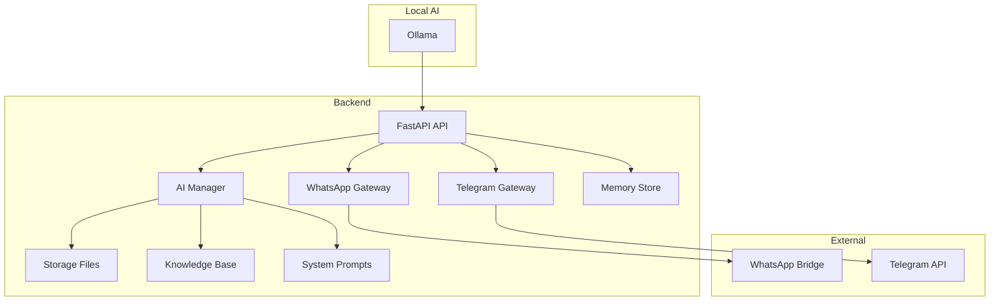

# Self-Hosted AI Assistant


[](https://github.com/naborajs/Self-Hosted-AI-Assistant)
[](./WHATSAPP_SETUP.md)
[](./TELEGRAM_SETUP.md)
[](./OLLAMA_SETUP.md)
[](./LICENSE)

## Project Banner

A privacy-first, local AI assistant platform for WhatsApp, Telegram, and Ollama. Configure behavior, train the model with knowledge, manage personalities, and control memory — all without touching code.

---

- Local Ollama-powered AI inference with dynamic discovery and non-silent fallback
- Controlled AI tool execution framework with sandboxed workspace and human-in-the-loop confirmation
- WhatsApp companion device bridge integration
- Telegram chat gateway support
- Durable SQLite WAL messaging inbox and delivery queue with crash recovery
- Long-term memory store with deterministic relevance retrieval and injection protection
- Professional Terminal Interface (`edith` CLI) with `--json` automation output
- AI identity and personality management
- Global and platform-specific system prompts
- Preset reply engine with exact, keyword, and regex match
- Knowledge base and training import system
- Admin API for runtime configuration with loopback-only default exposure
- Machine Chat API (`POST /api/chat`, `POST /v1/chat`) for local developer and automation integrations
- Backup and restore for AI state
- Secure admin access and health monitoring

## Architecture Overview




## Installation

See [INSTALLATION.md](./INSTALLATION.md) and [SETUP.md](./SETUP.md).

## Quick Start

1. Clone the repository:

```bash
git clone https://github.com/naborajs/Self-Hosted-AI-Assistant.git
cd Self-Hosted-AI-Assistant
```

2. Install Python dependencies:

```bash
python -m pip install -r requirements.txt
```

3. Configure your environment:
   - Copy `.env.example` to `.env`.
   - Inspect installed models via `ollama list` and set `OLLAMA_MODEL` to your preferred installed model (e.g. `dolphin3:8b`, `gemma4:12b`, `llama3:8b`). EDITH will never download or pull models automatically.
4. Start the WhatsApp bridge (optional, if using WhatsApp):

```bash
cd whatsapp_bridge
npm install
npm start
```

5. Start the backend:

```bash
python main.py
```

6. Open `http://127.0.0.1:8000/docs` for API access.

7. Manage the assistant using the terminal CLI:

```bash
pip install -e .
edith doctor       # Diagnostic sanity check
edith status       # Operational overview
```
## WhatsApp Setup

Follow the complete step-by-step pairing and durable queuing guide in [WHATSAPP_SETUP.md](./WHATSAPP_SETUP.md) and [docs/whatsapp_integration.md](./docs/whatsapp_integration.md).

## Telegram Setup

Configure `TELEGRAM_BOT_TOKEN` in `.env` obtained from @BotFather. The Telegram gateway initializes asynchronously during startup and routes messages through the unified 8-stage conversation turn processor. If no token or a placeholder token is configured, the gateway gracefully skips polling without failing the application lifespan.

## Ollama Inference Engine

Inspect models currently installed on your local host using `ollama list`. Enter your chosen model in `.env` under `OLLAMA_MODEL` (e.g. `dolphin3:8b`, `gemma4:12b`, `llama3:8b`). EDITH strictly enforces a **zero auto-pull policy** and will never download models automatically in the background.

## Controlled Tool Execution

Tools are registered in `ai/tools.py` with strict permission classification (`READ_ONLY`, `NETWORK`, `CONFIRMATION_REQUIRED`).
- High-privilege tools (like filesystem write operations) stage a `PendingAction` in the database with a high-entropy hex confirmation token.
- Users must authorize the action by sending `/confirm <token>` within 120 seconds.
- Sandboxed file operations are strictly confined within `storage/workspace/` with path traversal defense.

## Documentation Index

- [Architecture Guide](./docs/architecture.md) — Unified 8-stage turn pipeline, persistence layer, and security boundaries.
- [Configuration Reference](./docs/configuration.md) & [CONFIGURATION.md](./CONFIGURATION.md) — Comprehensive environment variable table and security best practices.
- [Installation Guide](./docs/installation.md) & [INSTALLATION.md](./INSTALLATION.md) — Prerequisites, virtual environments, and setup steps.
- [Local Deployment & Operations Guide](./docs/deployment.md) — Process supervisors, Windows batch scripts, and production hardening.
- [Startup & Migration Summary](./STARTUP_GUIDE.md) — Quick startup commands and pipeline details.
- [Troubleshooting & Diagnostics Guide](./docs/troubleshooting.md) — Automated `edith doctor` checks and resolutions for common issues.
- [WhatsApp Integration Guide](./docs/whatsapp_integration.md) — Baileys sidecar bridge architecture, QR display, and endpoints.

## License

This project is open source under the MIT License.
