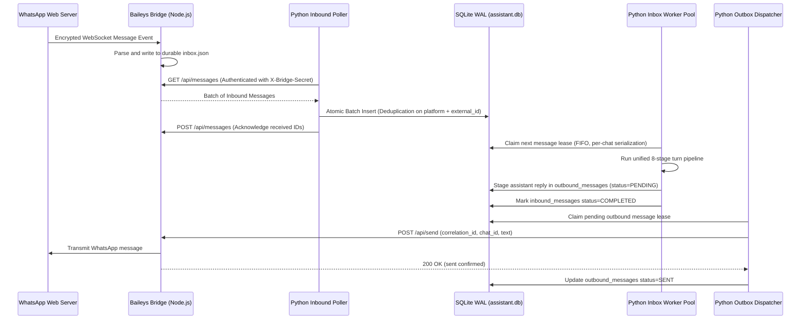

# Project EDITH v2.0 — WhatsApp Companion Integration

Project EDITH integrates with WhatsApp via an isolated Node.js companion bridge utilizing the `@whiskeysockets/baileys` multi-device library.

---

## Architecture Overview



---

## 1. Security Safeguards

1. **Loopback Only (`127.0.0.1`):** The bridge listener only binds to `127.0.0.1`, preventing exposure to external LANs.
2. **Timing-Safe Authentication:** All endpoints (except `/health`) require `X-Bridge-Secret` or `Authorization: Bearer <secret>`. Secret strings are compared using `crypto.timingSafeEqual` to thwart timing attacks.
3. **Encrypted Auth State:** Baileys credentials and session keys stored in `auth_state/` are encrypted at rest using AES-256-GCM derived from `SESSION_SECRET`.
4. **Anti-CSRF QR Display:** The browser QR viewer at `/qr-display` rejects non-local Host headers and cross-site requests (`Sec-Fetch-Site`).

---

## 2. Pairing Your WhatsApp Account

You can pair using either QR code scanning or an 8-character pairing code.

### Option A — Web Browser QR Pairing (Recommended)
1. Start the bridge:
   ```cmd
   cd whatsapp_bridge
   npm start
   ```
2. Open your local browser to:
   ```
   http://127.0.0.1:3000/qr-display
   ```
3. Open WhatsApp on your primary phone:
   - Go to **Settings** $\to$ **Linked Devices** $\to$ **Link a Device**.
   - Point your phone camera at the QR code on your screen.
4. Once paired, the page will update to indicate `CONNECTED`.

### Option B — Pairing Code via CLI
1. Request a pairing code for your phone number:
   ```bash
   curl -X POST http://127.0.0.1:3000/api/pair \
     -H "X-Bridge-Secret: your_bridge_secret" \
     -H "Content-Type: application/json" \
     -d '{"phone_number": "1234567890"}'
   ```
2. Enter the generated 8-digit code in WhatsApp under **Link with phone number instead**.

---

## 3. Endpoints Reference

| Endpoint | Method | Auth | Description |
| :--- | :--- | :--- | :--- |
| `/health` | `GET` | None | Public liveness probe. |
| `/api/status` | `GET` | Secret | Returns socket state (`connected`, `connecting`, `qr_ready`, `disconnected`). |
| `/api/qr` | `GET` | Secret | Returns raw QR code terminal string or data URL. |
| `/qr-display` | `GET` | Loopback | Visual web page for browser pairing. |
| `/api/pair` | `POST` | Secret | Requests an 8-digit phone pairing code. |
| `/api/messages` | `GET` | Secret | Polls queued inbound messages from `inbox.json`. |
| `/api/messages` | `POST` | Secret | Acknowledges and clears ingested message IDs. |
| `/api/send` | `POST` | Secret | Dispatches an outbound message or media attachment. |
| `/api/typing` | `POST` | Secret | Sends typing indicator to a target chat. |
| `/api/logout` | `POST` | Secret | Disconnects the socket and wipes local session auth keys. |
